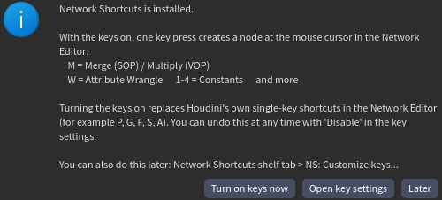
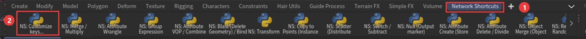
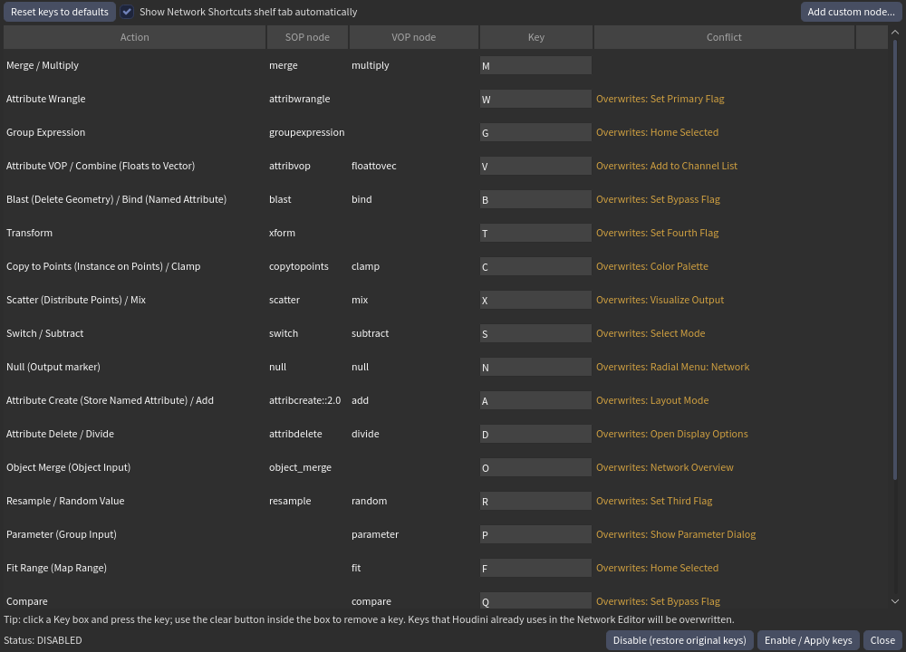
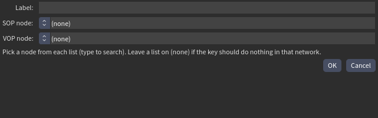

# Houdini Network Shortcuts

**キーを1回押すだけで、マウスカーソルの位置にノードが作れます。** Blender の Geometry Nodes や Unreal のような感覚で、Houdini の Network Editor を使えます。同じキーでも、いま開いているネットワークに合ったノードが作られます。`M` は SOP なら **Merge**、VOP なら **Multiply** です。

[**⬇ 最新版をダウンロード (zip)**](https://github.com/RenOshiro/Houdini_Quick_Nodes_shortcut_plugin/releases/latest/download/houdini-network-shortcuts.zip)  ·  [English](README.md)

> 動作確認は **Houdini 22.0.466 (Windows)** のみです。macOS、Linux、ほかのバージョンは未検証です。

## かんたん導入 (3ステップ・約2分)

**1. インストール** 上のリンクから zip をダウンロードし、好きな場所に展開して、**`install.bat` をダブルクリック**します(Windows。Python は不要です)。事前に Houdini を一度起動して、設定フォルダを作っておいてください。

**2. Houdini を起動** 案内ウィンドウが出るので、**Turn on keys now** をクリックします。



**3. Houdini を一度だけ再起動** これで完了です。

SOP か VOP のネットワークを開き、ノードを置きたい場所にマウスを置いて、キーを押してください。

| キー | SOP ネットワーク | VOP ネットワーク |
|---|---|---|
| `M` | Merge | Multiply |
| `W` | Attribute Wrangle | |
| `V` | Attribute VOP | Combine (Floats to Vector) |
| `1` `2` `3` `4` | | Constant Float / Vector2 / 3 / 4 |
| `Ctrl+P` | | Parameter |

全 21 キーは、下のキー設定ウィンドウで確認できます。自動で結線はしません。SOP と VOP 以外のネットワークでは何も起きません。

> **注意:** 初期設定のキーは、Houdini 標準の Network Editor の単独キー(`G`、`F`、`S`、`A` など。パラメータ表示の `P` は残します)を置き換えます。**Disable** でいつでも元のキーに戻せます。

## どこを触ればいい？

起動時とファイルを開いたときに、Shelf の **Network Shortcuts** タブが自動で開きます。



1. Network Shortcuts タブです。タブ内のツールは、クリックでも使えます。
2. **NS: Customize keys...** で、キー設定ウィンドウが開きます。

### キーの変更・オン/オフ・自作ノード



- **Key** 欄をクリックして、割り当てたいキーを押します。**Conflict** 欄に、置き換わる Houdini 標準のキーが出ます。同じキーを2つに使うと赤くなり、保存できません。
- **Enable / Apply keys** で変更を保存し、**Disable (restore original keys)** で全部オフにします。どちらも Houdini の再起動が必要です。下の「Status」で、ENABLED / DISABLED を確認できます。
- **Reset keys to defaults** で、初期のキー配置に戻ります。
- **Add custom node...** で、自分のキーを作れます。**Create node** を選ぶと、ラベルを入れ、SOP ノードと VOP ノードを検索できる一覧から選べます(どちらかは `(none)` でも構いません)。**Run Python script** を選ぶと、Python スクリプトを実行するアクションを追加できます。スクリプトでは `hou`、`editor`、`parent`、`kind`、`cursor` が使え、どの種類のネットワークでも実行できます(ネットワークに関する変数は `None` になる場合があります)。自作アクションには **Delete** ボタンが付きます。スクリプトの例:

  ```python
  # あいさつを表示
  hou.ui.displayMessage('hi')
  ```



## 更新・オフ・アンインストール

- **更新:** 新しい zip をダウンロードして、もう一度 `install.bat` を実行します。設定は残ります。
- **オフにするだけ:** キー設定ウィンドウで **Disable** を押し、Houdini を再起動します。
- **アンインストール:** 先に Disable して Houdini を再起動し、ターミナルで `install.bat --uninstall` を実行します。キーがオンのままだと、拒否されます。`--purge` を付けないと、設定は残ります。

Disable は、**最初に Enable した時点**のキーボード設定に戻します。そのあとに他の Houdini のホットキーを変えていた場合、その変更も元に戻ります。

## ほかのインストール方法

`python install.py` でも、同じことができます(`hython install.py` も可)。ほかの OS でも使えます。`--list` で見つかった Houdini を表示し、`--houdini-dir <フォルダ>` で選び、`--all` で 20.5 以上すべてに入れます。20.5 より古い Houdini は、スキップします。

ライセンス: MIT
