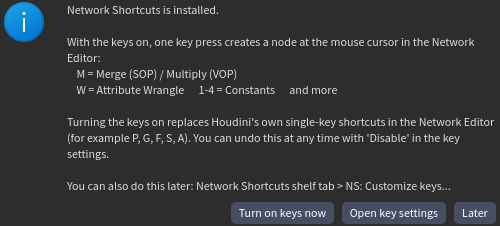
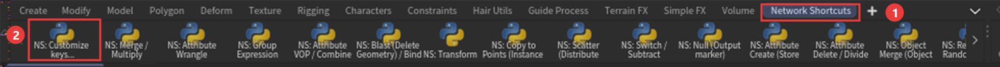
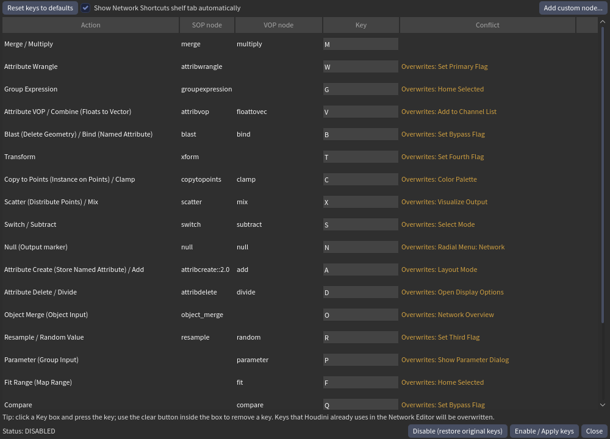
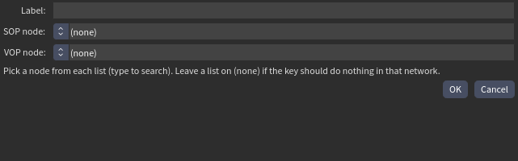

# Houdini Network Shortcuts

**Press one key, get a node at your mouse cursor** in the Houdini Network Editor, the way you add nodes in Blender Geometry Nodes or Unreal. The same key makes the right node for the network you are in: `M` = **Merge** in SOP, **Multiply** in VOP.

[**⬇ Download the latest version (zip)**](https://github.com/RenOshiro/Houdini_Quick_Nodes_shortcut_plugin/releases/latest/download/houdini-network-shortcuts.zip)  ·  [日本語](README.ja.md)

> Tested on **Houdini 22.0.466 (Windows)** only. macOS, Linux and other Houdini versions are untested.

## Quick start (3 steps, about 2 minutes)

**1. Install.** Download the zip above, unzip it anywhere, and **double-click `install.bat`** (Windows; no Python needed). Start Houdini at least once before this, so its settings folder exists.

**2. Start Houdini.** A welcome window appears. Click **Turn on keys now**.



**3. Restart Houdini once.** That's it.

Now open a SOP or VOP network, put the mouse where you want the node and press a key:

| Key | In a SOP network | In a VOP network |
|---|---|---|
| `M` | Merge | Multiply |
| `W` | Attribute Wrangle | |
| `V` | Attribute VOP | Combine (Floats to Vector) |
| `1` `2` `3` `4` | | Constant Float / Vector2 / 3 / 4 |
| `P` | | Parameter |

The full list (21 keys) is in the key settings window below. Nothing is wired automatically, and other network types are left alone.

> **Heads up:** the default keys replace Houdini's own single-key shortcuts in the Network Editor (for example `P`, `G`, `F`, `S`, `A`). You can undo this at any time with **Disable**, which restores your original keys.

## Where is everything?

A **Network Shortcuts** tab is opened for you on the shelf at startup (and after you open a file).



1. The Network Shortcuts shelf tab. The tools on it also work by clicking.
2. **NS: Customize keys...** opens the key settings window.

### Change keys, turn on/off, add your own nodes



- Click a **Key** box and press the key you want. The **Conflict** column tells you which Houdini key it would replace; two actions on the same key turn red and cannot be applied.
- **Enable / Apply keys** saves your changes; **Disable (restore original keys)** turns everything off. Both need one Houdini restart. The status line shows ENABLED / DISABLED.
- **Reset keys to defaults** puts the default layout back.
- **Add custom node...** makes your own key: type a label and pick a SOP node and a VOP node from searchable lists (either can be `(none)`). Your own nodes get a **Delete** button.



## Update, turn off, uninstall

- **Update:** download the new zip and run `install.bat` again. Your settings are kept.
- **Turn off only:** key settings window > **Disable**, then restart Houdini.
- **Uninstall:** Disable first, restart Houdini, then run `install.bat --uninstall` (in a terminal). It refuses while the keys are on. Your settings stay unless you add `--purge`.

Disable restores the keyboard settings as they were at your first Enable. If you changed other Houdini hotkeys after that, those changes are undone too.

## Other ways to install

`python install.py` does the same as `install.bat` on any OS (`hython install.py` also works). `--list` shows the Houdini folders it finds, `--houdini-dir <folder>` picks one, `--all` installs into every Houdini 20.5+ it finds, `--link` uses the folder in place (for developers). Houdini older than 20.5 is skipped.

## For developers

```
config/actions.json         action -> node per network
config/keys.json            default keys
python/network_shortcuts/   config.py runtime.py installer.py ui.py autoshelf.py welcome.py shelf.py
python3.*libs/uiready.py    startup hook (shelf tab, welcome window); coexists with other packages
toolbar/                    generated shelf
install.py / install.bat    installer
tools/make_release.py       builds dist/houdini-network-shortcuts.zip
tests/test_runtime.py       hython tests
```

Run the tests with `hython tests/test_runtime.py`, build a release zip with `python tools/make_release.py`. If you change `config/actions.json`, regenerate the shelf with `python python/network_shortcuts/shelf.py`.

Settings live in `<Houdini prefs>/network_shortcuts/user.json` (written by the window; hand editing works too):

```json
{
  "keys": { "transform": "Shift+T", "null": null },
  "auto_shelf": true,
  "actions": { "custom_remesh": { "label": "Remesh", "sop": { "type": "remesh::2.0" } } }
}
```

License: MIT
